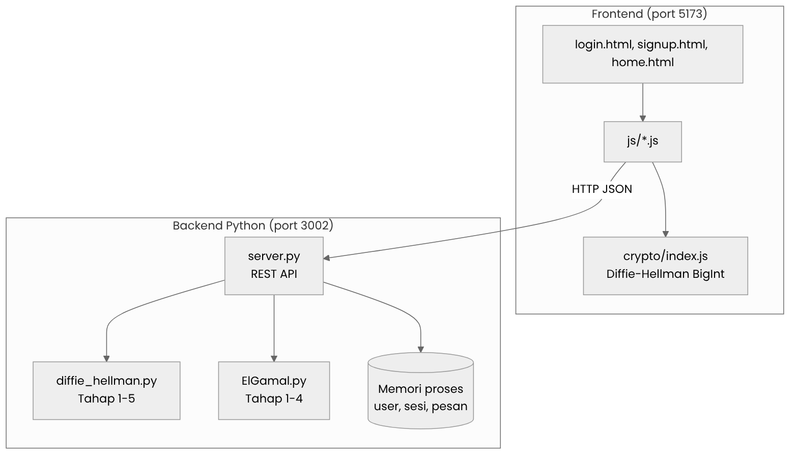
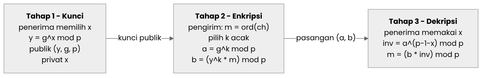
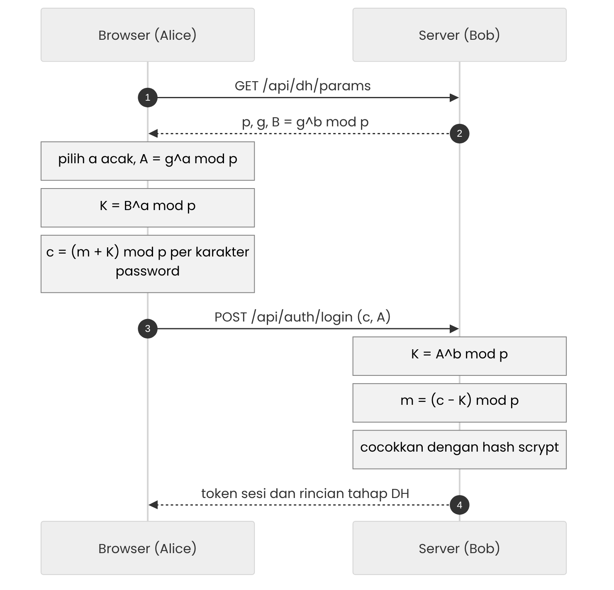
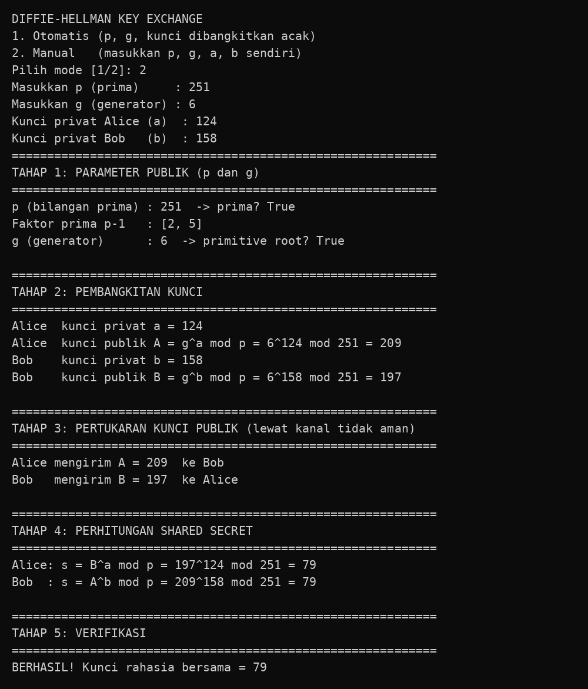
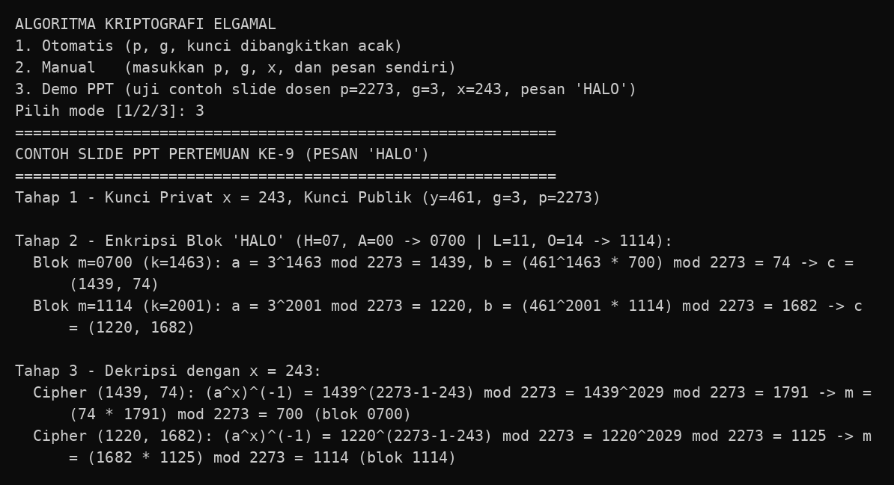
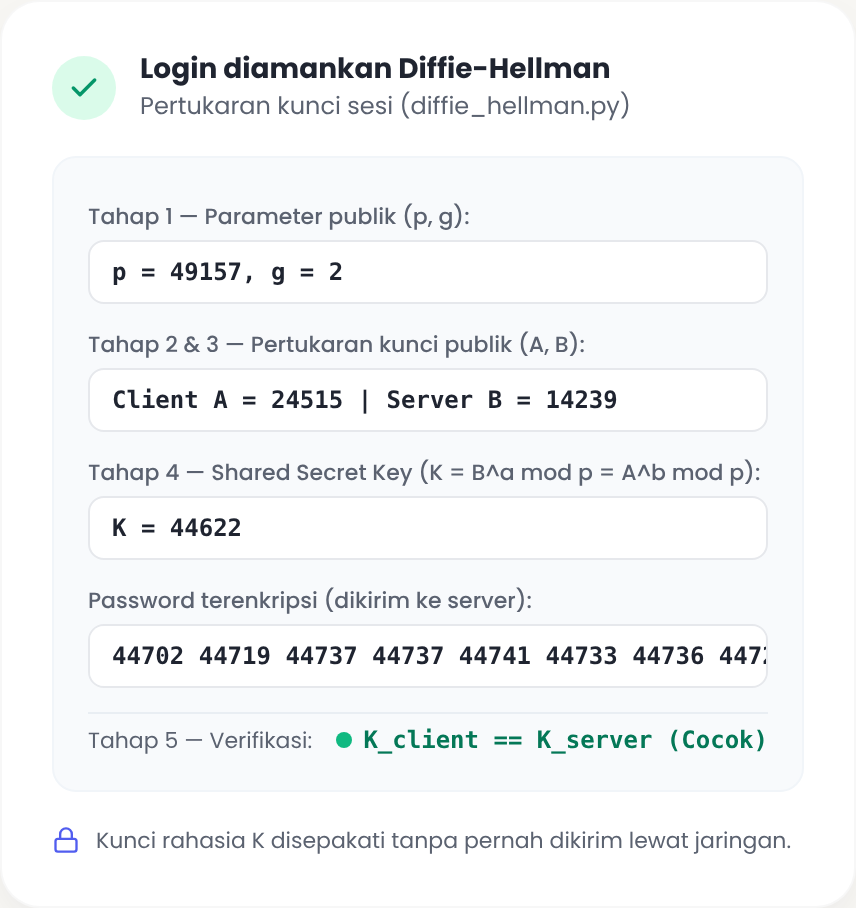
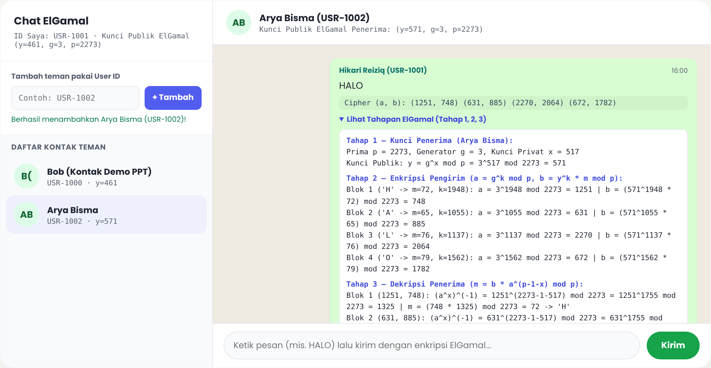
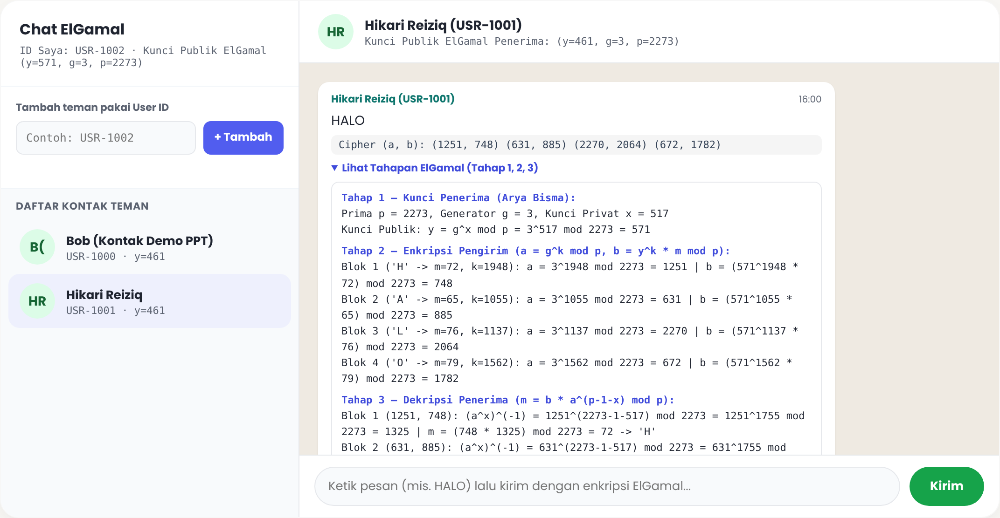

# Laporan Program Kriptografi

## Implementasi Pertukaran Kunci Diffie-Hellman pada Autentikasi Login dan Algoritma ElGamal pada Percakapan Antarakun

| Keterangan | Isi |
|---|---|
| Mata kuliah | Kriptografi (A) |
| Kelompok | Kelompok 4 |
| Dosen pengampu | Annisaa Sri Indrawanti, S.Kom., M.Kom. |
| Program studi | S-1 Teknologi Informasi, Fakultas Teknologi Elektro dan Informatika Cerdas |
| Institusi | Institut Teknologi Sepuluh Nopember, Surabaya |
| Semester | Gasal 2026/2027 |

**Anggota kelompok**

| No. | Nama lengkap | NRP |
|---:|---|---|
| 1 | Arya Bisma Putra Refman | 5027241036 |
| 2 | M. Hikari Reiziq Rakhmadinta | 5027241079 |
| 3 | Ahmad Syauqi Reza | 5027241085 |


## 1. Pendahuluan

### 1.1 Latar Belakang

Komunikasi pada jaringan terbuka menuntut dua kemampuan keamanan yang saling melengkapi. Kemampuan pertama adalah menyepakati kunci rahasia bersama antara dua pihak yang belum pernah bertukar rahasia, tanpa mengirimkan kunci tersebut melalui kanal. Persoalan ini diselesaikan oleh protokol pertukaran kunci Diffie-Hellman (Diffie & Hellman, 1976). Kemampuan kedua adalah mengenkripsi pesan dengan kunci publik penerima sehingga hanya pemilik kunci privat yang dapat membukanya. Persoalan ini diselesaikan antara lain oleh algoritma ElGamal, yang keamanannya juga bertumpu pada sulitnya logaritma diskrit (ElGamal, 1985).

Pada tugas ini, kelompok membangun program yang mengimplementasikan kedua algoritma tersebut tanpa library atau framework kriptografi jadi. Seluruh operasi inti, yaitu perpangkatan modular, uji keprimaan, pencarian akar primitif, pembangkitan kunci, enkripsi, dan dekripsi, ditulis sendiri. Kedua algoritma kemudian diterapkan pada sebuah aplikasi web agar fungsi setiap tahapannya dapat diamati secara langsung. Diffie-Hellman dipakai pada proses pendaftaran dan login, sedangkan ElGamal dipakai pada fitur percakapan antarpengguna.

### 1.2 Tujuan

1. Mengimplementasikan algoritma Diffie-Hellman dari nol dan menampilkan seluruh tahapannya, yaitu Tahap 1 sampai Tahap 5.
2. Mengimplementasikan algoritma ElGamal dari nol dan menampilkan seluruh tahapannya, yaitu pembangkitan kunci, enkripsi, dekripsi, dan verifikasi.
3. Menerapkan Diffie-Hellman pada alur pendaftaran dan login untuk melindungi pengiriman kata sandi.
4. Menerapkan ElGamal pada percakapan antarakun yang dihubungkan melalui User ID.
5. Menguji kebenaran program menggunakan contoh soal pada materi perkuliahan dan pengujian endpoint aplikasi.

### 1.3 Batasan dan Ketentuan

- Tidak menggunakan library atau framework kriptografi jadi. Modul `random` pada Python hanya dipakai untuk membangkitkan bilangan acak, sedangkan seluruh logika kriptografi ditulis sendiri.
- Backend memakai modul standar Python (`http.server`) tanpa framework web, dan frontend memakai JavaScript murni dengan tipe `BigInt`.
- Fungsi `hashlib.scrypt` dari pustaka standar hanya dipakai untuk menyimpan hash kata sandi di server. Fungsi ini tidak termasuk dalam implementasi Diffie-Hellman maupun ElGamal.
- Parameter yang digunakan berukuran kecil agar setiap angka perhitungan dapat diperiksa secara manual. Konsekuensinya dibahas pada Bagian 6.


## 2. Landasan Teori

### 2.1 Logaritma Diskrit

Misalkan p adalah bilangan prima dan g adalah akar primitif modulo p. Menghitung y = g<sup>x</sup> mod p untuk x yang diketahui dapat dilakukan dengan cepat. Sebaliknya, menemukan x dari y, g, dan p yang diketahui adalah masalah logaritma diskrit yang dianggap sulit untuk p yang cukup besar. Kesulitan inilah yang menjadi dasar keamanan Diffie-Hellman dan ElGamal.

### 2.2 Akar Primitif

Bilangan g disebut akar primitif modulo p jika pangkat g membangkitkan seluruh elemen 1 sampai p-1. Secara praktis, g adalah akar primitif jika g<sup>(p-1)/q</sup> mod p ≠ 1 untuk setiap faktor prima q dari p-1. Program menggunakan uji ini pada fungsi `is_primitive_root`.

### 2.3 Algoritma Diffie-Hellman

Dua pihak, Alice dan Bob, menyepakati parameter publik p dan g. Masing-masing memilih kunci privat acak, menghitung kunci publik, saling bertukar kunci publik, lalu menghitung kunci rahasia bersama.

<p align="center"><em>A</em> = <em>g</em><sup><em>a</em></sup> mod <em>p</em> &emsp;&emsp; <em>B</em> = <em>g</em><sup><em>b</em></sup> mod <em>p</em></p>

<p align="center"><em>K</em> = <em>B</em><sup><em>a</em></sup> mod <em>p</em> = <em>A</em><sup><em>b</em></sup> mod <em>p</em> = <em>g</em><sup><em>ab</em></sup> mod <em>p</em></p>

Penyadap yang hanya mengetahui p, g, A, dan B harus menyelesaikan logaritma diskrit untuk mendapatkan K.

### 2.4 Algoritma ElGamal

ElGamal adalah algoritma kunci publik yang terdiri dari tiga proses. Pada pembangkitan kunci, penerima memilih kunci privat x dengan 1 < x < p-1, lalu menghitung kunci publik y. Kunci publik berupa tiga bilangan (y, g, p).

<p align="center"><em>y</em> = <em>g</em><sup><em>x</em></sup> mod <em>p</em></p>

Pada enkripsi, pengirim mengubah pesan menjadi blok bilangan m dengan 0 ≤ m ≤ p-1, memilih bilangan acak k dengan 1 < k < p-1 untuk setiap blok, lalu menghitung pasangan cipherteks (a, b).

<p align="center"><em>a</em> = <em>g</em><sup><em>k</em></sup> mod <em>p</em> &emsp;&emsp; <em>b</em> = (<em>y</em><sup><em>k</em></sup> · <em>m</em>) mod <em>p</em></p>

Pada dekripsi, penerima menggunakan kunci privat x. Invers modulo (a<sup>x</sup>)<sup>-1</sup> dihitung dengan Teorema Kecil Fermat, yaitu a<sup>p-1</sup> ≡ 1 (mod p), sehingga a<sup>p-1-x</sup> adalah invers dari a<sup>x</sup>.

<p align="center"><em>m</em> = (<em>b</em> · <em>a</em><sup><em>p</em>-1-<em>x</em></sup>) mod <em>p</em></p>

Kebenaran dekripsi dapat dibuktikan secara langsung. Karena b = y<sup>k</sup> · m = g<sup>xk</sup> · m dan a<sup>x</sup> = g<sup>kx</sup>, maka b · (a<sup>x</sup>)<sup>-1</sup> = g<sup>xk</sup> · m · g<sup>-kx</sup> = m. Karena k dipilih acak untuk setiap blok, pesan yang sama menghasilkan cipherteks yang berbeda pada setiap pengiriman (enkripsi probabilistik).

### 2.5 Algoritma Pendukung

- **Perpangkatan modular (square-and-multiply).** Menghitung base<sup>exp</sup> mod mod dengan memeriksa bit eksponen dari paling kanan, sehingga kompleksitasnya O(log exp) dan tidak pernah membentuk bilangan sebesar base<sup>exp</sup>.
- **Uji keprimaan Miller-Rabin.** Uji probabilistik yang menguji apakah n lolos sebagai bilangan prima untuk sejumlah basis acak (Rabin, 1980). Program memakai 20 putaran.
- **Faktorisasi dengan pembagian percobaan.** Dipakai untuk mendapatkan faktor prima p-1 pada uji akar primitif.


## 3. Perancangan dan Implementasi

### 3.1 Arsitektur Program

Program terdiri dari dua modul kriptografi mandiri yang dapat dijalankan lewat terminal, satu backend, dan satu frontend. Modul `diffie_hellman.py` dan `ElGamal.py` diimpor langsung oleh backend sehingga kode yang diuji lewat terminal sama dengan kode yang berjalan pada aplikasi web.

```text
Kriptografi_Diffie-Hellman-dan-ElGamal/
├── diffie_hellman.py     Modul dan CLI Diffie-Hellman (Tahap 1 sampai 5)
├── ElGamal.py            Modul dan CLI ElGamal (Tahap 1 sampai 4)
├── crypto/index.js       Diffie-Hellman BigInt di sisi browser
├── backend/
│   ├── server.py         Server HTTP Python (port 3002)
│   └── .env.example      Konfigurasi dan data seeding akun
└── frontend/
    ├── login.html, signup.html, home.html
    ├── dev_server.py     Server statis (port 5173)
    ├── css/              Gaya halaman
    └── js/               Autentikasi, cuaca, teman, dan chat
```

<p align="center"></p>

<p align="center"><em>Gambar 1. Arsitektur aplikasi dan hubungan antarmodul</em></p>

### 3.2 Fungsi Dasar Bersama

Fungsi `mod_exp` mengimplementasikan metode square-and-multiply. Fungsi ini dipakai oleh seluruh tahap pada kedua algoritma.

```python
def mod_exp(base, exp, mod):
    """Perpangkatan modular (square-and-multiply): base^exp mod mod."""
    result = 1
    base %= mod
    while exp > 0:
        if exp & 1:                      # bit terakhir = 1
            result = (result * base) % mod
        base = (base * base) % mod       # kuadratkan
        exp >>= 1                        # geser bit
    return result
```

Fungsi `is_prime` mengimplementasikan Miller-Rabin, `prime_factors` memfaktorkan p-1, dan `is_primitive_root` serta `find_generator` mencari akar primitif.

```python
def is_primitive_root(g, p, factors):
    """g adalah generator mod p jika g^((p-1)/q) != 1 untuk semua faktor prima q dari p-1."""
    return all(mod_exp(g, (p - 1) // q, p) != 1 for q in factors)


def find_generator(p):
    """Tahap 1b: cari generator (primitive root) g dari p."""
    factors = prime_factors(p - 1)
    for g in range(2, p):
        if is_primitive_root(g, p, factors):
            return g
    return None
```

### 3.3 Implementasi Diffie-Hellman

Setiap tahap pada modul `diffie_hellman.py` dipetakan ke fungsi tertentu, dan fungsi `run` mencetak hasil tiap tahap secara berurutan.

**Tabel 1. Pemetaan tahap Diffie-Hellman ke fungsi program**

| Tahap | Proses | Fungsi | Rumus |
|---|---|---|---|
| 1 | Menetapkan parameter publik p dan g, serta memeriksa keprimaan dan akar primitif | `is_prime`, `prime_factors`, `is_primitive_root`, `find_generator` | g<sup>(p-1)/q</sup> mod p ≠ 1 |
| 2 | Membangkitkan kunci privat dan kunci publik Alice dan Bob | `generate_private_key`, `generate_public_key` | A = g<sup>a</sup> mod p, B = g<sup>b</sup> mod p |
| 3 | Mempertukarkan kunci publik melalui kanal tidak aman | `run` | A dikirim ke Bob, B dikirim ke Alice |
| 4 | Menghitung kunci rahasia bersama pada kedua pihak | `compute_shared_secret` | K = B<sup>a</sup> mod p, K = A<sup>b</sup> mod p |
| 5 | Memverifikasi kedua kunci bernilai sama | `run` | K<sub>Alice</sub> = K<sub>Bob</sub> |

```python
def generate_private_key(p):
    """Tahap 2: kunci privat acak 2 <= x <= p-2."""
    return random.randrange(2, p - 1)


def generate_public_key(g, private, p):
    """Tahap 2: kunci publik = g^private mod p."""
    return mod_exp(g, private, p)


def compute_shared_secret(other_public, my_private, p):
    """Tahap 4: shared secret = (kunci publik lawan)^(kunci privat saya) mod p."""
    return mod_exp(other_public, my_private, p)
```

### 3.4 Implementasi ElGamal

**Tabel 2. Pemetaan tahap ElGamal ke fungsi program**

| Tahap | Proses | Fungsi | Rumus |
|---|---|---|---|
| 1 | Membangkitkan kunci privat x dan kunci publik (y, g, p) | `generate_keys` | y = g<sup>x</sup> mod p |
| 2 | Mengenkripsi setiap blok m menjadi pasangan (a, b) dengan k acak | `encrypt_block`, `encrypt_text` | a = g<sup>k</sup> mod p, b = (y<sup>k</sup> · m) mod p |
| 3 | Menghitung invers modulo dan mendekripsi pasangan (a, b) | `decrypt_block`, `decrypt_text` | m = (b · a<sup>p-1-x</sup>) mod p |
| 4 | Membandingkan hasil dekripsi dengan plainteks awal | `run` | plainteks = hasil dekripsi |

Fungsi `encrypt_block` memproses satu blok. Nilai m dipastikan berada pada rentang 0 sampai p-1, dan k dibangkitkan baru untuk setiap blok.

```python
def encrypt_block(m, y, g, p, k=None):
    """
    Tahap 2 ElGamal (per blok integer m):
    - Pilih bilangan acak k (1 < k < p - 1)
    - Hitung a = g^k mod p
    - Hitung b = (y^k * m) mod p
    """
    if m < 0 or m >= p:
        raise ValueError(f"Nilai blok m={m} harus berada di rentang [0, {p - 1}]")
    if k is None:
        k = random.randrange(2, p - 1)
    a = mod_exp(g, k, p)
    yk = mod_exp(y, k, p)
    b = (yk * m) % p
    return {
        "m": m,
        "k": k,
        "a": a,
        "b": b,
        "yk": yk,
        "formula_a": f"{g}^{k} mod {p} = {a}",
        "formula_b": f"({y}^{k} * {m}) mod {p} = {b}",
    }
```

Fungsi `decrypt_block` menghitung invers modulo melalui Teorema Kecil Fermat tanpa algoritma Euclid yang diperluas.

```python
def decrypt_block(a, b, x, p):
    """
    Tahap 3 ElGamal (per pasangan cipherteks (a, b)):
    - Hitung invers modulo (a^x)^(-1) = a^(p - 1 - x) mod p (Teorema Kecil Fermat)
    - Hitung plainteks m = (b * (a^x)^(-1)) mod p
    """
    inv_exp = p - 1 - x
    ax_inv = mod_exp(a, inv_exp, p)
    m = (b * ax_inv) % p
    return {
        "a": a,
        "b": b,
        "inv_exp": inv_exp,
        "ax_inv": ax_inv,
        "m": m,
        "formula_inv": f"{a}^({p}-1-{x}) mod {p} = {a}^{inv_exp} mod {p} = {ax_inv}",
        "formula_m": f"({b} * {ax_inv}) mod {p} = {m}",
    }
```

<p align="center"></p>

<p align="center"><em>Gambar 3. Tiga tahap algoritma ElGamal</em></p>

Untuk pesan teks, `encrypt_text` mengubah setiap karakter menjadi kode `ord(ch)` sebagai satu blok. Akibatnya cipherteks berukuran dua kali plainteks, yaitu satu pasangan (a, b) untuk setiap karakter.

### 3.5 Penerapan Diffie-Hellman pada Login dan Pendaftaran

Server berperan sebagai Bob dan browser berperan sebagai Alice. Server menggunakan p = 49157 dan memilih g sebagai akar primitif terkecil, yaitu g = 2, melalui `find_generator`. Kunci privat server b dibangkitkan sekali saat server dijalankan. Alur untuk setiap login atau pendaftaran sebagai berikut.

1. Browser meminta parameter publik melalui `GET /api/dh/params` dan menerima (p, g, B).
2. Browser membangkitkan kunci privat a yang baru, menghitung A = g<sup>a</sup> mod p, lalu menghitung K = B<sup>a</sup> mod p.
3. Browser mengenkripsi setiap karakter kata sandi dengan c = (m + K) mod p, kemudian mengirim daftar c bersama A.
4. Server menghitung K = A<sup>b</sup> mod p menggunakan `compute_shared_secret`, lalu memulihkan setiap karakter dengan m = (c - K) mod p.
5. Server memverifikasi kata sandi terhadap hash scrypt yang tersimpan. Kata sandi tidak pernah dikirim sebagai teks biasa.

<p align="center"></p>

<p align="center"><em>Gambar 2. Alur Diffie-Hellman pada proses login</em></p>

Sisi browser pada berkas `crypto/index.js`.

```javascript
  // Tahap 2: Client (Alice) membangkitkan kunci privat a dan kunci publik A = g^a mod p
  const a = randomPrivateKey(p);
  const A = modPow(g, a, p);

  // Tahap 4: Client menghitung shared secret K = B^a mod p
  const K = modPow(B, a, p);

  // Enkripsi password menggunakan kunci simetris hasil Diffie-Hellman (K)
  const ciphertext = [];
  for (let i = 0; i < password.length; i += 1) {
    const m = BigInt(password.charCodeAt(i));
    const c = (m + K) % p;
    ciphertext.push(c.toString());
  }
```

Sisi server pada fungsi `decrypt_dh_password` di `backend/server.py`.

```python
def decrypt_dh_password(cipher_list, client_pub_a):
    """Tahap 4 Diffie-Hellman di server: hitung K = A^b mod p lalu buka password."""
    shared_k = diffie_hellman.compute_shared_secret(client_pub_a, DH_SERVER_PRIV_B, DH_P)
    chars = []
    for c_str in cipher_list:
        c_val = int(c_str)
        m_val = (c_val - shared_k) % DH_P
        chars.append(chr(m_val))
    return "".join(chars), shared_k
```

### 3.6 Penerapan ElGamal pada Percakapan

Setiap akun memiliki User ID unik, misalnya `USR-1001`, dan pasangan kunci ElGamal yang dibangkitkan melalui `ElGamal.generate_keys` dengan p = 2273 dan g = 3, sesuai contoh materi perkuliahan. Pengguna menambahkan teman dengan memasukkan User ID, lalu mengirim pesan. Untuk setiap pesan, server memanggil `ElGamal.encrypt_text` dengan kunci publik penerima dan `ElGamal.decrypt_text` dengan kunci privat penerima. Rincian Tahap 1, 2, dan 3 disimpan pada pesan dan dapat dilihat lewat tombol Lihat Tahapan ElGamal pada gelembung chat.

Dua akun siap pakai dibuat otomatis saat server dijalankan, sehingga pengujian dapat dilakukan pada dua tab browser tanpa mendaftar.

**Tabel 3. Akun seeding dan kunci ElGamal**

| Akun | User ID | Email | Kata sandi | Kunci privat x | Kunci publik (y, g, p) |
|---|---|---|---|---|---|
| Hikari Reiziq | USR-1001 | hikari@its.ac.id | Password123 | 243 | (461, 3, 2273) |
| Arya Bisma | USR-1002 | bisma@its.ac.id | Password123 | 517 | (571, 3, 2273) |

Nilai y dapat diperiksa dengan rumus kunci publik. Untuk Hikari, 3<sup>243</sup> mod 2273 = 461. Untuk Bisma, 3<sup>517</sup> mod 2273 = 571.

### 3.7 Endpoint Backend

**Tabel 4. Daftar endpoint backend**

| Metode dan Endpoint | Fungsi |
|---|---|
| `GET /api/dh/params` | Mengirim parameter publik Diffie-Hellman (p, g, B) |
| `POST /api/auth/register` | Mendaftarkan akun, memulihkan kata sandi lewat K, membuat User ID dan kunci ElGamal |
| `POST /api/auth/login` | Memverifikasi kata sandi lewat K dan menerbitkan token sesi |
| `POST /api/friends/add` | Menambahkan teman berdasarkan User ID |
| `GET /api/friends` | Menampilkan daftar teman dan kunci publik ElGamal |
| `POST /api/chat/send` | Mengenkripsi dan mendekripsi pesan dengan ElGamal |
| `GET /api/chat/messages` | Mengambil riwayat percakapan beserta tahapan ElGamal |
| `GET /api/weather` | Menampilkan cuaca kota dari OpenWeather (fitur tambahan) |


## 4. Cara Menjalankan Program

### 4.1 Mode Terminal

```bash
python3 diffie_hellman.py     # pilih mode 2, lalu isi p=251, g=6, a=124, b=158
python3 ElGamal.py            # pilih mode 3 untuk contoh slide, atau mode 2 untuk pesan sendiri
```

### 4.2 Aplikasi Web

Jalankan dua terminal dari direktori utama proyek.

```bash
python3 backend/server.py        # backend, port 3002
python3 frontend/dev_server.py   # frontend, port 5173
```

Buka `http://localhost:5173` pada dua tab browser. Login sebagai `hikari@its.ac.id` pada tab pertama dan `bisma@its.ac.id` pada tab kedua dengan kata sandi `Password123`. Pada tab pertama, masukkan `USR-1002` pada kolom tambah teman, kirim pesan, lalu buka rincian tahapan ElGamal pada gelembung pesan. Fitur cuaca membutuhkan `OPENWEATHER_API_KEY` pada `backend/.env` dan tidak memengaruhi fungsi kriptografi.


## 5. Hasil Pengujian

### 5.1 Diffie-Hellman dengan Contoh Slide

Pengujian memakai parameter contoh pada materi perkuliahan, yaitu p = 251, g = 6, a = 124, dan b = 158. Hasil berikut adalah keluaran program.

**Tabel 5. Hasil Diffie-Hellman pada contoh slide**

| Tahap | Perhitungan | Hasil |
|---|---|---|
| 1 | p = 251 bilangan prima, faktor prima p-1 adalah 2 dan 5, g = 6 akar primitif | Valid |
| 2 | A = 6<sup>124</sup> mod 251 | 209 |
| 2 | B = 6<sup>158</sup> mod 251 | 197 |
| 3 | Alice mengirim A = 209, Bob mengirim B = 197 | Terkirim |
| 4 | K<sub>Alice</sub> = 197<sup>124</sup> mod 251 | 79 |
| 4 | K<sub>Bob</sub> = 209<sup>158</sup> mod 251 | 79 |
| 5 | K<sub>Alice</sub> = K<sub>Bob</sub> | Cocok, K = 79 |

<p align="center"></p>

<p align="center"><em>Gambar 4. Tampilan keluaran diffie_hellman.py pada contoh slide</em></p>

### 5.2 ElGamal dengan Contoh Slide

Pengujian memakai p = 2273, g = 3, dan x = 243 sehingga y = 3<sup>243</sup> mod 2273 = 461. Pesan HALO dipecah menjadi dua blok, yaitu H=07 dan A=00 menjadi 0700, serta L=11 dan O=14 menjadi 1114. Nilai k ditetapkan sama dengan contoh, yaitu 1463 dan 2001.

**Tabel 6. Enkripsi ElGamal pada contoh slide**

| Blok | m | k | a = 3<sup>k</sup> mod 2273 | b = (461<sup>k</sup> · m) mod 2273 | Cipherteks |
|---|---|---|---|---|---|
| 1 | 700 | 1463 | 1439 | 74 | (1439, 74) |
| 2 | 1114 | 2001 | 1220 | 1682 | (1220, 1682) |

**Tabel 7. Dekripsi ElGamal pada contoh slide**

| Blok | Cipherteks | Invers (a<sup>x</sup>)<sup>-1</sup> = a<sup>2029</sup> mod 2273 | m = (b · invers) mod 2273 | Hasil |
|---|---|---|---|---|
| 1 | (1439, 74) | 1791 | 74 · 1791 mod 2273 = 700 | 0700 |
| 2 | (1220, 1682) | 1125 | 1682 · 1125 mod 2273 = 1114 | 1114 |

Hasil dekripsi kembali ke 0700 dan 1114 sehingga pesan HALO pulih sepenuhnya. Eksponen invers dihitung sebagai p-1-x = 2273-1-243 = 2029.

<p align="center"></p>

<p align="center"><em>Gambar 5. Tampilan keluaran ElGamal.py mode 3 (contoh slide HALO)</em></p>

### 5.3 ElGamal dengan Pesan Teks Berbasis ASCII

Pengujian kedua memakai mode manual dengan p = 2273, g = 3, x = 243, dan pesan HALO. Pada mode ini setiap karakter diperlakukan sebagai satu blok berdasarkan kode ASCII-nya, dan nilai k dibangkitkan acak oleh program.

**Tabel 8. Enkripsi dan dekripsi pesan HALO per karakter**

| Blok | Karakter | m | k | Cipherteks (a, b) | Invers | Hasil |
|---|---|---|---|---|---|---|
| 1 | H | 72 | 650 | (1263, 1155) | 1724 | H |
| 2 | A | 65 | 1724 | (1521, 1788) | 2226 | A |
| 3 | L | 76 | 542 | (1435, 959) | 1882 | L |
| 4 | O | 79 | 730 | (1732, 1482) | 1566 | O |

Program menampilkan Plainteks awal HALO dan Hasil dekripsi HALO, kemudian mencetak pesan BERHASIL pada Tahap 4. Karena k dibangkitkan acak, nilai cipherteks pada eksekusi lain akan berbeda tetapi hasil dekripsinya tetap HALO.

### 5.4 Pengujian Endpoint Aplikasi Web

Backend dijalankan dan setiap endpoint dipanggil dengan klien uji yang menjalankan Diffie-Hellman menggunakan fungsi `diffie_hellman.py`. Pada salah satu eksekusi login, server menggunakan p = 49157, g = 2, dan B = 25725. Klien memilih a, mengirim A = 30103, dan kedua pihak memperoleh K = 16223 (server menghitung 30103<sup>6426</sup> mod 49157 = 16223).

**Tabel 9. Hasil pengujian endpoint**

| No. | Skenario | Endpoint | Status | Hasil |
|---|---|---|---|---|
| 1 | Mengambil parameter Diffie-Hellman | `GET /api/dh/params` | 200 | Mengembalikan (p, g, B) |
| 2 | Login Hikari dengan kata sandi benar | `POST /api/auth/login` | 200 | K klien sama dengan K server, token sesi terbit |
| 3 | Login dengan kata sandi salah | `POST /api/auth/login` | 401 | INVALID_CREDENTIALS |
| 4 | Login Bisma | `POST /api/auth/login` | 200 | Kunci publik ElGamal (571, 3, 2273) |
| 5 | Pendaftaran akun baru | `POST /api/auth/register` | 201 | USR-1003 terbentuk |
| 6 | Pendaftaran dengan email yang sama | `POST /api/auth/register` | 409 | EMAIL_TAKEN |
| 7 | Tambah teman USR-1002 | `POST /api/friends/add` | 200 | Kontak terhubung |
| 8 | Tambah teman dengan ID yang tidak ada | `POST /api/friends/add` | 404 | USER_NOT_FOUND |
| 9 | Menambahkan diri sendiri | `POST /api/friends/add` | 400 | CANNOT_ADD_SELF |
| 10 | Kirim pesan HALO ke USR-1002 | `POST /api/chat/send` | 201 | Cipherteks 4 pasangan, plainteks HALO pulih |
| 11 | Kirim pesan HALO yang sama sekali lagi | `POST /api/chat/send` | 201 | Cipherteks berbeda, plainteks tetap HALO |
| 12 | Penerima membaca riwayat pesan | `GET /api/chat/messages` | 200 | Dua pesan HALO terbaca |
| 13 | Kirim pesan tanpa token sesi | `POST /api/chat/send` | 401 | UNAUTHORIZED |

Pada skenario 10 dan 11 dikirim pesan yang sama dengan kunci yang sama, dan cipherteks yang dihasilkan berbeda.

**Tabel 10. Sifat probabilistik ElGamal pada pesan yang sama**

| Pengiriman | Cipherteks (a, b) untuk H, A, L, O |
|---|---|
| Pertama | (1403, 1678), (996, 1976), (1371, 1294), (1190, 1353) |
| Kedua | (601, 1149), (1147, 1448), (709, 1609), (1003, 763) |

Dekripsi pengiriman pertama dengan x = 517 memberikan m = 72, 65, 76, dan 79 yang sesuai dengan huruf H, A, L, dan O. Perbedaan cipherteks pada pesan yang identik menunjukkan bahwa bilangan acak k diganti untuk setiap blok.

### 5.5 Tampilan Aplikasi Web

Gambar berikut diambil dari aplikasi yang berjalan, menampilkan halaman masuk, halaman pendaftaran, bukti Diffie-Hellman setelah login, dan percakapan ElGamal dari sisi pengirim maupun penerima.

<p align="center"></p>

<p align="center"><em>Gambar 6. Halaman login</em></p>

<p align="center"></p>

<p align="center"><em>Gambar 7. Halaman pendaftaran</em></p>

Setelah login, kartu Login diamankan Diffie-Hellman menampilkan parameter publik, kunci publik klien A dan server B, kunci rahasia K, kata sandi terenkripsi, dan hasil verifikasi K klien sama dengan K server. Nilai pada gambar berbeda untuk setiap login karena kunci privat klien dibangkitkan acak.

<p align="center"></p>

<p align="center"><em>Gambar 8. Rincian tahap Diffie-Hellman pada halaman utama</em></p>

Pada percakapan, Hikari (USR-1001) mengirim pesan HALO ke Bisma (USR-1002). Tombol Lihat Tahapan ElGamal membuka kunci penerima (Tahap 1), pasangan a dan b hasil enkripsi (Tahap 2), serta invers modulo dan hasil dekripsi (Tahap 3).

<p align="center"></p>

<p align="center"><em>Gambar 9. Chat ElGamal dari sisi pengirim (Hikari)</em></p>

<p align="center"></p>

<p align="center"><em>Gambar 10. Chat ElGamal dari sisi penerima (Bisma), pesan terdekripsi dengan x = 517</em></p>


## 6. Analisis dan Pembahasan

### 6.1 Peran Setiap Algoritma

Diffie-Hellman menyelesaikan masalah distribusi kunci. Pada login, kunci privat a milik browser dan b milik server tidak pernah dikirim, dan kunci K yang dipakai untuk membungkus kata sandi tidak melintasi jaringan. Penyadap hanya melihat p, g, A, B, dan daftar cipherteks kata sandi. Karena a dibangkitkan baru pada setiap permintaan, K berbeda pada setiap sesi login sehingga cipherteks kata sandi yang sama tidak berulang.

ElGamal menyelesaikan masalah kerahasiaan pesan dengan kunci asimetris. Pengirim hanya membutuhkan kunci publik (y, g, p) penerima yang boleh diketahui siapa pun, sedangkan x hanya dipakai pada proses dekripsi. Sifat probabilistik pada Tabel 10 mencegah penyerang mengenali pesan yang berulang dari cipherteksnya.

### 6.2 Kompleksitas

Seluruh perpangkatan modular memakai square-and-multiply sehingga hanya membutuhkan O(log e) perkalian modular. Nilai a<sup>p-1-x</sup> pada dekripsi dihitung dengan cara yang sama tanpa mencari invers lewat pencarian linear. Pencarian akar primitif memakai pembagian percobaan pada p-1 sehingga hanya layak untuk p berukuran kecil, yang sesuai dengan tujuan demonstrasi.

### 6.3 Batasan Implementasi

- **Ukuran parameter.** Nilai p = 49157 (16 bit) dan p = 2273 (12 bit) dapat dipecahkan dengan pencarian ekshaustif dalam hitungan milidetik. Sistem nyata memakai p minimal 2048 bit atau kurva eliptik.
- **Enkripsi kata sandi dengan K.** Kata sandi dibungkus dengan penjumlahan modular c = (m + K) mod p. Skema ini cukup untuk memperagakan penggunaan K sebagai kunci simetris, tetapi bukan cipher yang aman. Pada sistem produksi, K diturunkan menjadi kunci untuk cipher simetris standar.
- **Autentikasi pihak lawan.** Diffie-Hellman tanpa autentikasi rentan terhadap serangan man-in-the-middle. Pada sistem nyata, parameter server diamankan dengan sertifikat TLS.
- **Rentang karakter pesan.** Pada chat, m = `ord(ch)` harus lebih kecil dari p = 2273, sehingga karakter dengan kode 2273 ke atas, seperti emoji, tidak dapat dienkripsi. Pada pengujian, pengiriman pesan berisi emoji membuat `encrypt_block` menolak nilai m, dan server belum menangkap pengecualian tersebut sehingga permintaan terputus tanpa respons.
- **Lokasi kunci privat.** Backend menyimpan kunci privat x semua pengguna di memori dan menjalankan dekripsi atas nama penerima. Rancangan ini memudahkan peragaan setiap tahap pada antarmuka, tetapi bukan enkripsi ujung ke ujung.
- **Penyimpanan.** Data pengguna, sesi, dan pesan disimpan di memori proses sehingga hilang saat server dihentikan. Akun seeding dibuat ulang pada setiap pemulaan server.

### 6.4 Saran Pengembangan

- Memperbesar ukuran p dan memakai penyandian blok yang menggabungkan beberapa karakter ke dalam satu m.
- Menangkap `ValueError` pada `handle_send_message` dan mengembalikan status 400 dengan pesan yang jelas.
- Menurunkan kunci simetris dari K dan memakai cipher standar untuk membungkus kata sandi.
- Memindahkan dekripsi ke sisi penerima agar kunci privat tidak berada di server.


## 7. Kesimpulan

1. Algoritma Diffie-Hellman berhasil diimplementasikan tanpa library kriptografi. Pada contoh slide (p = 251, g = 6, a = 124, b = 158), kedua pihak memperoleh kunci rahasia bersama K = 79, dan pada aplikasi web kunci klien dan server selalu sama sehingga kata sandi dapat dipulihkan oleh server tanpa melewatkan kunci privat.
2. Algoritma ElGamal berhasil diimplementasikan tanpa library kriptografi. Pada contoh slide (p = 2273, g = 3, x = 243), pesan HALO terenkripsi menjadi (1439, 74) dan (1220, 1682) dan terdekripsi kembali menjadi 0700 dan 1114, dengan invers modulo dihitung sebagai a<sup>p-1-x</sup> mod p.
3. Penerapan pada aplikasi web membuktikan fungsi setiap tahapan. Diffie-Hellman mengamankan login dan pendaftaran, sedangkan ElGamal mengamankan percakapan antarakun yang dihubungkan melalui User ID, dengan cipherteks yang berbeda pada setiap pengiriman.
4. Seluruh 13 skenario pengujian endpoint memberikan hasil sesuai harapan. Parameter yang kecil dan rancangan penyimpanan kunci di server menjadikan program ini sebagai media pembelajaran, bukan sistem untuk lingkungan produksi.


## Daftar Pustaka

1. Diffie, W., & Hellman, M. E. (1976). New directions in cryptography. IEEE Transactions on Information Theory, 22(6), 644–654.
2. ElGamal, T. (1985). A public key cryptosystem and a signature scheme based on discrete logarithms. IEEE Transactions on Information Theory, 31(4), 469–472.
3. Rabin, M. O. (1980). Probabilistic algorithm for testing primality. Journal of Number Theory, 12(1), 128–138.
4. Menezes, A. J., van Oorschot, P. C., & Vanstone, S. A. (1996). Handbook of Applied Cryptography. CRC Press.
5. Materi perkuliahan Kriptografi, Pertemuan ke-9 (Diffie-Hellman dan ElGamal), Departemen Teknologi Informasi, Institut Teknologi Sepuluh Nopember.
